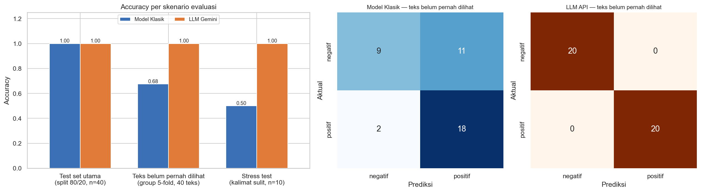

# AI Model Experiment & Evaluation — Sentiment Analysis Ulasan Pelanggan

**Individual Assignment · AI Engineering Bootcamp** — Abi Komara

Eksperimen yang membandingkan dua pendekatan AI untuk mengklasifikasikan sentimen ulasan produk e-commerce
(`positif` / `negatif`):

1. **Model klasik Machine Learning** — TF-IDF + Logistic Regression (Scikit-learn), dilatih sendiri.
2. **LLM API** — Google Gemini `gemini-3.5-flash-lite` dengan prompting zero-shot, tanpa training.



---

## 1. Problem Statement

**Objective.** Tim produk e-commerce ingin fitur otomatis yang mengklasifikasikan sentimen setiap ulasan pelanggan di
halaman produk. Sebelum memilih pendekatan untuk produksi, dua kandidat dibandingkan secara adil (pada test set yang
sama) untuk menghasilkan rekomendasi berbasis data.

**Target / label.** Kolom `sentiment`, klasifikasi biner:
- `positif` — pelanggan puas (kualitas baik, sesuai deskripsi, pengiriman/pelayanan cepat).
- `negatif` — pelanggan kecewa/mengeluh (rusak/cacat, tidak sesuai, lambat, pelayanan buruk).

Fitur input hanya `review_text`. `review_id` dan `product_name` tidak dipakai sebagai fitur.

**Batasan & asumsi.**
- Label di dataset dianggap *ground truth*.
- Hanya 2 kelas; ulasan netral/campuran dipaksa ke sentimen yang dominan.
- Dataset kecil dan sangat repetitif (lihat di bawah), jadi hasil evaluasi harus dibaca dengan hati-hati.
- LLM dipakai apa adanya lewat API (tanpa fine-tuning).
- Kedua pendekatan dievaluasi pada test set yang identik (split 80/20, stratified, `random_state=42`).
- Dataset asli di `data/` tidak diubah.

## 2. Dataset

`data/customer_reviews_sentiment.csv` — dataset resmi dari brief assignment.

| Properti | Nilai |
|---|---|
| Jumlah baris | 200 |
| Kolom | `review_id`, `product_name`, `review_text`, `sentiment` |
| Distribusi label | 110 positif (55%) · 90 negatif (45%) |
| Missing value | 0 |
| **Teks ulasan unik** | **40 (20%)** — tiap kalimat rata-rata muncul 5×, maksimal 12× |

**Temuan penting:** karena hanya ada 40 kalimat unik, split acak 80/20 menghasilkan **39 dari 40 baris test (98%)
yang teksnya identik dengan data train** (*data leakage*). Karena itu, selain evaluasi utama sesuai brief, ditambahkan
evaluasi pada teks yang benar-benar belum pernah dilihat.

## 3. Struktur Project

```
model-experiment-assignment/
├── data/
│   └── customer_reviews_sentiment.csv      # dataset asli (tidak diubah)
├── notebook/
│   ├── experiment_notebook.ipynb           # eksperimen lengkap (sudah dieksekusi, output tersimpan)
│   └── starter_notebook.ipynb              # starter asli dari bootcamp (referensi)
├── documentation/
│   ├── model_comparison_summary.png        # ringkasan visual semua skenario
│   ├── confusion_matrix_test_set.png       # confusion matrix + metrik di test set utama
│   ├── model_comparison.csv                # tabel metrik test set utama
│   ├── operational_comparison.csv          # latency, biaya, effort
│   ├── generalization_comparison.csv       # metrik pada teks yang belum pernah dilihat
│   ├── test_predictions.csv                # prediksi kedua pendekatan per ulasan test
│   ├── stress_test_results.csv             # hasil 10 kalimat sulit
│   ├── llm_call_log.csv                    # raw output, latency, token tiap panggilan LLM
│   └── llm_predictions_cache.json          # cache respon Gemini (notebook bisa dijalankan ulang tanpa API)
├── .env.example                            # template API key
├── .gitignore
├── README.md
└── requirements.txt
```

## 4. Ringkasan Eksperimen

### Pendekatan 1 — Model klasik (Scikit-learn)
- **Preprocessing:** `TfidfVectorizer(lowercase=True, ngram_range=(1, 2), sublinear_tf=True)`. Bigram dipakai agar frasa
  negasi seperti "tidak sesuai" terbaca sebagai satu fitur. Vectorizer hanya di-`fit` pada train set.
- **Model:** `LogisticRegression(max_iter=1000, random_state=42)` — baseline yang cepat, stabil untuk data kecil
  berdimensi tinggi, dan bisa diinterpretasi (bobot per kata).
- Training ±2 ms, inferensi < 0,1 ms per ulasan.

### Pendekatan 2 — LLM API (Gemini)
- **Model:** `gemini-3.5-flash-lite`, versi dipin eksplisit. (`gemini-2.0-flash` di starter sudah tidak tersedia.)
- **Prompt:** zero-shot. System instruction berisi peran, definisi tiap label, dan aturan untuk negasi, sarkasme, dan
  ulasan campuran. Contoh di aturan sengaja memakai kalimat yang tidak ada di dataset. User content hanya berisi ulasan.
- **Constrained output:** `response_mime_type="text/x.enum"` + `response_schema` enum `["negatif", "positif"]`, lalu tetap
  dinormalisasi (`lowercase`, `strip`, mapping ke label valid) sebagai lapisan pengaman kedua. Hasil: 0 output tidak valid.
- **Parameter:**

| Parameter | Nilai | Alasan |
|---|---|---|
| `temperature` | `0.0` | Klasifikasi butuh jawaban deterministik & konsisten; tidak ada manfaat variasi/kreativitas |
| `response_schema` | enum 2 label | Model hanya bisa menjawab label valid, tidak perlu parsing teks bebas |
| Throttle | 4 detik antar request | Aman dari rate limit free tier |
| Retry | exponential backoff, 5× | Menangani error sementara (429/5xx) |

- **Kenapa zero-shot, bukan few-shot?** Sentimen biner sudah sangat dikuasai LLM; few-shot menambah token (biaya &
  latency) di setiap panggilan; dan karena dataset sangat repetitif, contoh few-shot dari train set berisiko hampir
  identik dengan teks test sehingga perbandingan tidak adil.
- Respon di-cache per teks (in-memory + file JSON). Rata-rata ~212 token input dan 2 token output per panggilan;
  latency rata-rata ±1 detik.

### Uji tambahan
- **Generalisasi:** `StratifiedGroupKFold` 5-fold dengan `groups=review_text`, sehingga teks di fold uji tidak pernah muncul
  saat training. Dievaluasi pada 40 teks unik (masing-masing tepat sekali menjadi data uji).
- **Stress test:** 10 kalimat buatan sendiri di luar dataset (negasi, sarkasme, campuran, slang, kosakata baru).

## 5. Hasil Evaluasi & Perbandingan

### 5.1 Test set utama (split 80/20 yang sama, n = 40)

| Pendekatan | Accuracy | Precision (macro) | Recall (macro) | F1 (macro) | Recall negatif |
|---|---|---|---|---|---|
| Model Klasik (TF-IDF + LogReg) | 1.00 | 1.00 | 1.00 | 1.00 | 1.00 |
| LLM API (gemini-3.5-flash-lite) | 1.00 | 1.00 | 1.00 | 1.00 | 1.00 |

Confusion matrix keduanya identik: `[[18, 0], [0, 22]]` (baris = aktual negatif/positif, kolom = prediksi).

**Interpretasi:** keduanya benar untuk semua ulasan — tidak ada keluhan yang terlewat dan tidak ada ulasan positif
yang salah dicap negatif. Namun skor model klasik **tidak valid sebagai ukuran generalisasi** karena 98% teks test sudah
ada di train set (model cukup menghafal). LLM tidak pernah melihat data train, jadi skornya murni kemampuan zero-shot.

### 5.2 Teks yang belum pernah dilihat (group 5-fold, 40 teks unik)

| Pendekatan | Accuracy | Precision (macro) | Recall (macro) | F1 (macro) | Recall negatif |
|---|---|---|---|---|---|
| Model Klasik | **0.50** (± 0.12 antar fold) | 0.50 | 0.50 | 0.50 | 0.50 |
| LLM API | **1.00** (± 0.00) | 1.00 | 1.00 | 1.00 | 1.00 |

Confusion matrix model klasik `[[10, 10], [10, 10]]` — setara lempar koin; LLM `[[20, 0], [0, 20]]`.

**Interpretasi:** pada kalimat baru, model klasik kehilangan kemampuan membedakan kelas. Analisis bobot fitur
menunjukkan ia belajar **kata kunci, bukan makna**. Contoh:
- *"Kualitas produk sangat memuaskan, akan order lagi."* → **negatif**, karena "memuaskan" tidak ada di vocabulary
  training, sedangkan "akan order lagi" hanya pernah muncul di ulasan negatif "...tidak akan order lagi disini".
- *"Pengalaman belanja terburuk, tidak akan order lagi disini."* → **positif** (kebalikannya: "terburuk" tidak dikenal).
- *"Bahan nyaman dipakai, ukuran pas, tidak mengecewakan."* → **negatif**, karena kata positifnya tidak dikenal dan yang
  tersisa ("tidak", "ukuran", "bahan") di data train muncul di keluhan.

### 5.3 Stress test (10 kalimat sulit, label manual — kualitatif)

| Pendekatan | Benar |
|---|---|
| Model Klasik | 5/10 — salah pada ulasan campuran, slang, kosakata baru, dan negasi ("Tidak sesuai harapan, tidak akan beli lagi" → positif) |
| LLM API | 10/10 |

### 5.4 Perbandingan operasional

| Aspek | Model Klasik | LLM API |
|---|---|---|
| Butuh data berlabel & training | Ya | Tidak |
| Waktu training | ±2 ms | – |
| Latency per ulasan | < 0,1 ms | ±1.000 ms |
| Biaya per 1.000 ulasan | ~0 (CPU lokal) | ±USD 0,07 |
| Biaya per 1 juta ulasan | ~0 | ±USD 68 |

Estimasi biaya memakai harga paid tier Gemini 3.5 Flash-Lite (USD 0,30 / 1 juta token input, USD 2,50 / 1 juta token
output, per September 2026) dan rata-rata token hasil eksperimen.

## 6. Analisis Trade-off & Limitation

**Performa.** Di test set utama keduanya seri (1.00), tetapi hasil ini bias oleh leakage. Pada teks baru — kondisi
nyata di produksi — **LLM jauh lebih unggul** (1.00 vs 0.50), termasuk pada metrik yang paling penting secara bisnis,
yaitu recall kelas `negatif` (keluhan yang terlewat = masalah yang tidak ditindaklanjuti).

**Trade-off.**

| Aspek | Model Klasik | LLM API |
|---|---|---|
| Effort implementasi | Butuh data berlabel yang banyak & beragam, training, retraining | Tanpa training; prompt + integrasi API |
| Kecepatan | Sangat cepat, bisa batch jutaan data di laptop | ~1 detik/ulasan, terkena rate limit |
| Biaya | Praktis nol | Berulang, naik linear dengan volume |
| Generalisasi | Lemah dengan data sekecil ini | Kuat (zero-shot) |
| Interpretabilitas | Tinggi (bobot kata terlihat) | Rendah (*black box*) |
| Kontrol & privasi | Deterministik, offline, data tetap internal | Bergantung vendor & internet; teks dikirim ke pihak ketiga |

**Limitation — model klasik:** menghafal alih-alih memahami; kata di luar vocabulary diabaikan; negasi hanya tertangkap
jika bigram-nya pernah dilihat; rentan asosiasi kata yang salah konteks.

**Limitation — LLM API:** latency & rate limit (butuh throttling, retry, proses asinkron); biaya berulang (~90% token
input adalah system instruction yang dikirim ulang); **ketergantungan vendor terbukti di eksperimen ini** —
`gemini-2.0-flash` dan `gemini-2.5-flash-lite` sudah tidak tersedia sehingga kode harus diubah; skor 1.00 diperoleh
pada data yang bersih dan belum tentu sama pada ulasan nyata; tidak ada penjelasan untuk setiap label.

**Limitation — eksperimen:** dataset sintetis & repetitif (40 kalimat unik); test set kecil; hanya satu varian prompt
dan satu model LLM; stress test kecil dan dilabeli sendiri.

## 7. Rekomendasi Technical Approach

**Kembangkan Pendekatan 2 — LLM API (Gemini) sebagai solusi awal, dengan guardrail produksi, sambil mengumpulkan data
untuk model sendiri di tahap berikutnya.**

Alasan:
1. **Generalisasi adalah hal yang paling menentukan di produksi.** Ulasan baru hampir selalu berupa kalimat yang belum
   pernah dilihat; di kondisi ini LLM mencapai 1.00, model klasik hanya 0.50 dan melewatkan separuh ulasan negatif.
2. **Skor sempurna model klasik di test set utama tidak bisa dijadikan dasar keputusan** karena leakage 98%.
3. **Masalah model klasik ada di data, bukan algoritma.** Dengan 40 kalimat unik, model tidak bisa andal; LLM tidak
   butuh data training sehingga fitur bisa dirilis sekarang.
4. **Biaya & latency LLM masih wajar untuk use case ini:** ±USD 68 per 1 juta ulasan, dan latency ~1 detik tidak
   terasa pengguna jika klasifikasi dijalankan asinkron saat ulasan dikirim, lalu hasilnya disimpan.

Guardrail implementasi: constrained output + normalisasi + `temperature=0`; simpan hasil di database dan cache teks
identik; pin versi model, simpan log (raw output, latency, token), dan jalankan ulang evaluasi setiap ganti model atau
prompt; retry + backoff dengan fallback status "pending"; manfaatkan batch processing dan context caching untuk menekan
biaya.

**Kapan rekomendasi berubah:** setelah terkumpul ribuan ulasan nyata (dilabeli LLM + dicek manusia pada sampel), atau
jika volume sangat besar, latency harus < 50 ms, atau data tidak boleh keluar dari server sendiri, latih model sendiri
(TF-IDF + LogReg pada data yang beragam, atau fine-tune model seperti IndoBERT). Pada kondisi itu model klasik menjadi
opsi yang lebih murah dan cepat — tetapi **setelah** datanya cukup, bukan dengan dataset saat ini.

## 8. Cara Menjalankan

**Prasyarat:** Python 3.10+ dan API key Gemini ([Google AI Studio](https://aistudio.google.com/apikey)).

```bash
# 1. Clone repository
git clone https://github.com/<username>/assignment-model-experiment-abi-komara.git
cd assignment-model-experiment-abi-komara

# 2. Buat & aktifkan virtual environment
python -m venv venv
source venv/bin/activate          # Windows: venv\Scripts\activate

# 3. Install dependencies
pip install -r requirements.txt

# 4. Siapkan API key
cp .env.example .env              # lalu isi GEMINI_API_KEY di file .env

# 5. Jalankan notebook
jupyter notebook notebook/experiment_notebook.ipynb
```

Lalu jalankan semua cell (**Run All**). Alternatif tanpa membuka Jupyter:

```bash
jupyter nbconvert --to notebook --execute --inplace notebook/experiment_notebook.ipynb
```

Catatan:
- Respon Gemini tersimpan di `documentation/llm_predictions_cache.json`, sehingga notebook bisa dijalankan ulang
  **tanpa memanggil API** (dan tanpa API key) dengan hasil yang identik. Hapus file tersebut untuk memanggil API dari awal
  (±50 panggilan, ±4 menit karena throttling).
- File `.env` sudah masuk `.gitignore` dan tidak akan ter-push ke GitHub.
